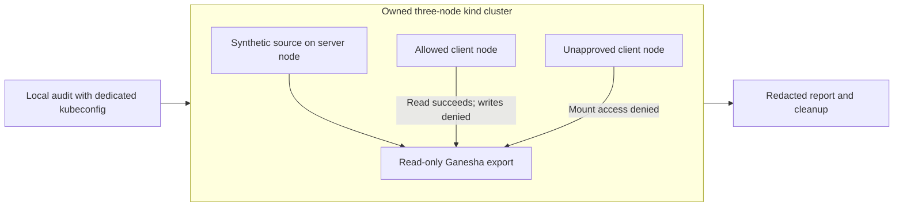
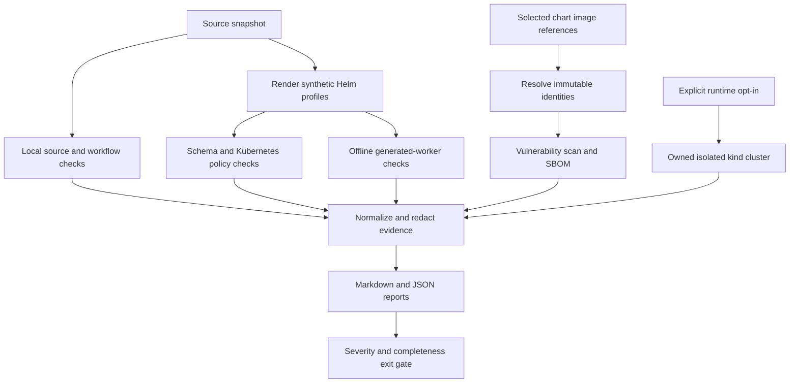
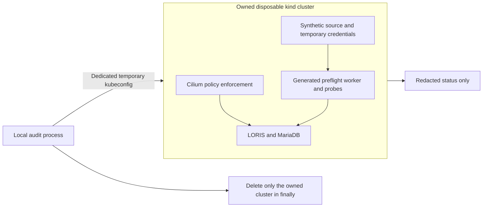

# LORIS chart security audits

Evaluate the chart, custom code, rendered Kubernetes resources, generated import
Jobs, public container images, and release workflows. Each run produces:

- a Markdown report;
- versioned JSON evidence;
- CycloneDX image SBOMs.

The audit also runs as a GitHub workflow.

Select the chart with `--chart`:

- `--chart loris` (the default) audits the portal.
- `--chart loris-nfs-export` audits the site exporter.

Both share tool installation, reporting, severity gates, and CI, but use
chart-specific profiles and runtime checks.

> [!IMPORTANT]
> Passing automated gates is not a security certification. Alerts require human triage.

## Quick start

From the repository root, using Linux x86_64 and Python 3.12:

```sh
python3 tools/security/loris/setup.py
export PATH="$PWD/.audit-tools/bin:$PWD/.audit-tools/venv/bin:$PATH"
python tools/security/loris/audit.py --output audit-results/local
```

Setup:

- downloads pinned Helm, Trivy, kubeconform, ShellCheck, and actionlint binaries;
- verifies the archive SHA-256 checksums in `tools.json`;
- installs pinned direct Python dependencies in `.audit-tools/venv`.

> [!WARNING]
> Choose an empty output directory for each run to prevent stale evidence.

> [!NOTE]
> The default output directory is `audit-results/<chart>`. Outputs and scanner
> installations are ignored by Git and stay outside the packaged charts.

## Exporter audit

```sh
python tools/security/loris/audit.py \
  --chart loris-nfs-export --output audit-results/loris-nfs-export
```

Exporter coverage includes:

- **Render profiles**:
  - dormant defaults, path-only, and clients-only profiles, each required to
    render no resources;
  - an enabled profile;
  - a custom-port/identity/multiple-client profile;
  - an exact missing-group validation failure.
- **Schema and policy**: Helm lint, pinned Kubernetes schemas, and embedded Trivy
  policies for enabled Deployments and the Dockerfile.
- **Explicit assertions**: read-only source mount, root filesystem, capabilities,
  host network, port consistency, single replica/Recreate, and hostname pinning.
- **Shell and repository checks**: recursive ShellCheck and shell syntax checks,
  including `image/entrypoint.sh` and `prepare-source.sh`; chart secrets and
  release/workflow checks.
- **Image evidence**: a required immutable exporter-image dependency scan and
  `exporter.cdx.json`.
  - The exporter has no database image.
  - `--app-image` selects its exporter image.
  - `--database-image` is rejected for this chart.

> [!NOTE]
> Semgrep is explicitly marked not applicable if there are no supported
> Python/PHP/JavaScript sources; it is not reported as a successful source scan.

> [!WARNING]
> The current legacy `prepare-source.sh` has a syntax defect. The report therefore
> marks executable shell coverage incomplete rather than silently treating an
> unparseable file as clean. The helper is never run, and source permissions are
> never changed by the static audit.

The literal entrypoint contract check is a regression guard, not proof of NFS
enforcement. Trusted operator CIDRs are interpolated into Ganesha configuration.
Manual review must verify:

- the CIDRs themselves;
- filesystem groups and mode bits;
- site-owner consent;
- root and capability risk;
- host-port routing and firewalls;
- transport protection.

> [!CAUTION]
> `sec=sys` and a CIDR list do not provide cryptographic authentication or
> encryption. No scanner findings are automatically suppressed as "expected."

### Exporter runtime validation

```sh
python3 tools/security/loris/setup.py --runtime
export PATH="$PWD/.audit-tools/bin:$PWD/.audit-tools/venv/bin:$PATH"
python tools/security/loris/audit.py --chart loris-nfs-export \
  --runtime --output audit-results/exporter-runtime
```

> [!NOTE]
> Runtime validation is an explicit opt-in. It creates an owned **three-node**
> kind cluster using the same pinned node image as portal runtime tests. It never
> reads site source directories or reuses the active kubeconfig.

Requirements:

- a local Unix-socket Docker daemon;
- Linux x86_64;
- kubectl;
- pinned kind 0.33.0;
- a pullable exporter digest that passed image scanning;
- at least 16 GiB free disk and 4 GiB available memory.

Test environment:

- The server gets synthetic files inside its kind node container.
- The allowed and denied client nodes install `nfs-common` inside their
  disposable containers. Client test package versions are distribution-resolved,
  not part of the exporter SBOM.
- No host package installation or host firewall/rpcbind change is performed.
- The default kind CNI is sufficient: the exporter chart has no NetworkPolicy to
  validate.

Runtime tests verify:

1. Exporter readiness on a synthetic read-only hostPath with group-mode access.
2. An allowed client can mount NFSv4.1 on the configured port and read data.
3. A write attempt from a client requesting an `rw` mount fails with `EROFS`,
   proving server-side read-only behavior rather than only a client `ro` flag.
4. Client root cannot read a root-only file, exercising `all_squash`.
5. A second node outside the allowlist receives an explicit mount access denial;
   timeout or connectivity failure is not accepted as proof.
6. The source fixture remains unchanged and the allowed mount is removed.

> [!WARNING]
> The host kernel/container filesystem must support Ganesha VFS file handles and
> NFS client mounts. A failure is reported as a required runtime error, not a pass.

These checks do **not** prove:

- encrypted transport;
- production firewall behavior;
- restart recovery;
- performance;
- full BIDS compatibility;
- absence of a server vulnerability.



Text equivalent: a dedicated kubeconfig addresses only an owned cluster. One
node serves synthetic data, one permitted node tests reads/write rejection, and
one unapproved node tests CIDR denial. The runner deletes only that named cluster
in `finally`; no real site data is involved. Cleanup failure is an error.

> [!TIP]
> If host/process failure interrupts cleanup, inspect `kind get clusters` and
> remove only your `loris-nfs-audit-<unique-suffix>` cluster.

## Audit pipeline



Coverage

| Surface                      | Automated evidence                                                                                      | Important boundary                                                                |
| ---------------------------- | ------------------------------------------------------------------------------------------------------- | --------------------------------------------------------------------------------- |
| Chart defaults               | Helm lint/render, including an intentionally empty disabled render                                      | Disabled defaults alone do not audit a deployment.                                |
| Enabled development          | Ephemeral deployment render, schema and policy checks                                                   | Risky development settings are reported, not exempted.                            |
| Persistent/TLS profile       | Persistent claims and dedicated-host TLS ingress                                                        | Synthetic settings are not production certification.                              |
| NFS/import profile           | PVs, PVCs, CronJob, ServiceAccount, Role/Binding, offline worker Job                                    | No real NFS server is contacted.                                                  |
| Worker generation            | Executes only selected chart dispatch helpers against an in-memory API                                  | Tests token/root-credential removal and scans the resulting Job.                  |
| Kubernetes schemas           | kubeconform with explicit Kubernetes version and pinned schema repository revision                      | No missing-schema bypass.                                                         |
| Kubernetes/Dockerfile policy | Trivy's embedded policies with an isolated empty policy cache                                           | Does not consume a mutable cached/remote policy bundle.                           |
| Secrets                      | Local Trivy chart scan                                                                                  | Matches/snippets are never published; not a guarantee that all secrets are found. |
| Python/PHP/JavaScript        | Reviewed local Semgrep heuristics                                                                       | Not a full taint analysis or manual review of upstream LORIS.                     |
| Shell                        | ShellCheck                                                                                              | ShellCheck levels are normalized separately from exploitability.                  |
| Workflows                    | actionlint and action-pin/permission/privileged-PR-trigger checks                                       | Release credentials and branch protections require operator review.               |
| Shipped dependencies         | Exact image vulnerability reports and CycloneDX SBOMs                                                   | Build-only dependencies and upstream source require separate manual review.       |
| Optional runtime             | Isolated deployment, real preflight worker, RBAC/token, source write denial, database network isolation | Synthetic PVC source, not NFS transport or complete MRI import testing.           |

> [!NOTE]
> Profiles are in `profiles/`. `imports.yaml` is intentionally suspended to
> prevent scheduled jobs during inspection; offline worker generation is still
> evaluated.

### Reproducibility

The report records:

- a source-tree SHA-256, including uncommitted source content, not merely the
  current Git commit;
- scanner versions and commands;
- the schema revision;
- vulnerability database timestamps;
- image identities and platform;
- coverage and errors.

> [!WARNING]
> Run in a stable checkout: editing files while scanning fails the source
> snapshot check.

> [!NOTE]
> Vulnerability databases intentionally update; their timestamps explain changes
> in findings between otherwise equivalent runs.

## Images and dependency evidence

Required image scans by chart:

- **Portal**: the runner reads the application and MariaDB references from chart
  defaults, resolves the actual scanned identity, then scans that immutable
  reference. Application and database scans are required, even if a profile
  disables workloads.
- **Exporter**: only its exporter image is required; no MariaDB scan is run.

For an unpublished application image, supply a published replacement or an
explicit local Docker image:

```sh
python tools/security/loris/audit.py \
  --app-image registry.example.org/loris@sha256:REPLACE_WITH_64_HEX_DIGEST \
  --database-image mariadb:10.11.10 \
  --output audit-results/pinned

python tools/security/loris/audit.py \
  --image-source docker \
  --app-image local/loris:audit \
  --output audit-results/local-images
```

Image options:

- `--image-source docker` requires every selected chart image to exist in the
  local daemon. Default scans use remote public registries.
- `--platform` defaults to `linux/amd64` and also supports `linux/arm64`
  (runtime is Linux x86_64 only).

> [!NOTE]
> The runner never builds or pushes images. Keep a record of any separate trusted
> build and its provenance.

> [!WARNING]
> Each of the following is an error, not a clean result:
>
> - an inaccessible image;
> - an unverified immutable identity;
> - a missing package inventory;
> - a scanner error;
> - a stale vulnerability database.

> [!IMPORTANT]
> The public image might not match uncommitted local Dockerfile changes: image
> identity evidence and source evidence are separate and must be compared manually.

## Reports and exit policy

| Exit  | Meaning                                                                                                                        |
| ----- | ------------------------------------------------------------------------------------------------------------------------------ |
| `0` | All requested required checks completed and no high/critical findings were reported. Lower/unknown severities may still exist. |
| `1` | Completed checks reported high/critical findings, including untriaged scanner alerts.                                          |
| `2` | At least one required check failed or could not run, regardless of other findings.                                             |

> [!NOTE]
> Invalid CLI arguments and invalid output directories also exit `2`, before
> starting a report. Install Python dependencies before invoking the runner.

Output files:

- `report.md`: coverage/status tables, findings, remediation/retest guidance,
  limitations, and a Mermaid overview with an equivalent textual explanation.
- `report.json`: normalized findings and execution evidence, conforming to
  `report.schema.json`.
- `application.cdx.json`, `database.cdx.json`: SBOMs generated from the same
  scanned portal image evidence when those scans succeed. Exporter audits
  instead produce `exporter.cdx.json` when its image scan succeeds.

### Redaction

Kept out of persistent reports:

- raw source;
- rendered ConfigMap code;
- secret matches;
- scanner messages and code snippets;
- scanner stderr.

Retained in reports:

- rule IDs;
- resource/file locations;
- severity;
- dependency versions;
- check status.

> [!TIP]
> Investigate a failed scanner locally rather than publishing its raw output.

> [!CAUTION]
> SBOMs contain public-image package metadata and can reveal dependency
> inventories; apply an appropriate artifact access policy for private images.

### Triage

Do not conflate these categories:

- confirmed vulnerabilities;
- unverified scanner alerts;
- dependency advisories;
- hardening issues;
- blocked checks.

> [!IMPORTANT]
> Automated findings are marked **unverified** until a human establishes
> exploitability. The gate is conservative: untriaged high/critical alerts fail
> it. There is no suppression or baseline mechanism. Remediate or explicitly
> triage findings outside this tool, then rerun against the same profiles and
> digests.

## Optional portal runtime validation

> [!NOTE]
> **This is opt-in and can be blocked by host prerequisites.** It does not use:
>
> - the active kubeconfig or any existing cluster;
> - real NFS exports;
> - public ingress;
> - real research data;
> - production credentials.

```sh
python3 tools/security/loris/setup.py --runtime
export PATH="$PWD/.audit-tools/bin:$PWD/.audit-tools/venv/bin:$PATH"
python tools/security/loris/audit.py --runtime --output audit-results/runtime
```

Requirements:

- a working local Docker daemon;
- kubectl;
- pinned kind 0.33.0;
- Linux x86_64;
- at least 12 GiB free disk and 3 GiB available memory at runtime preflight;
- a host that meets Cilium's kernel requirements.

> [!WARNING]
> The disk and memory figures are minimum admission checks, not workload capacity
> guarantees. Remote Docker daemons and shared production hosts are not supported
> runtime targets.

Cluster setup:

- Runtime mode creates a uniquely named kind cluster using a digest-pinned
  Kubernetes 1.33.1 node and a checksum-pinned Cilium 1.18.2 chart.
- All CNI and workload changes are confined to that cluster.
- The runtime Kubernetes version is independent of `--kubernetes-version`, which
  selects static schemas.
- It uses the application/database identities that passed the image scan.
- Runtime requires pullable repository digests. Local-only image IDs are not
  supported, and private registry credentials are not provisioned into kind.

Runtime checks:

1. Deploys disposable credentials, a single portal, and synthetic source data.
2. Initializes a real import ledger.
3. Runs a generated `preflight` worker.
4. Checks admitted worker token absence and discovery RBAC.
5. Verifies source writes are rejected.
6. Checks permitted versus denied database connections with an enforcing CNI.

Runtime does **not** test the following; they remain environment-specific manual
tests:

- actual NFS transport;
- TLS/ingress/session security;
- authentication bypass;
- full imaging import;
- production admission controls.



Text equivalent: the runner uses a dedicated kubeconfig to access only its owned
cluster. Synthetic source, credentials, CNI, application, and probes live there.
Only redacted status leaves it; cleanup deletes that named cluster.

Normal errors trigger cleanup in `finally`; cleanup failure is a required-check
error. Cluster names appear in the redacted command evidence when a report can
be written.

> [!WARNING]
> Process termination or host failure can interrupt cleanup. If necessary,
> inspect `kind get clusters` and remove **only** the `loris-audit-<unique-suffix>`
> cluster created by your run; never delete unrelated clusters.

## GitHub Actions

`.github/workflows/loris-security-audit.yml` runs the same static/image command on
relevant pull requests, pushes to `main`, and manual dispatch.

Workflow properties:

- read-only repository permissions;
- no stored scanner credentials;
- pinned external actions;
- no `pull_request_target` event;
- reports/SBOMs uploaded even if the audit step fails;
- a static matrix that audits both charts independently with `fail-fast: false`
  and separate artifacts;
- runtime validation as a separate **manual-dispatch-only** job. For manual
  dispatch, select the chart for runtime validation and any optional image
  override; a blank override uses that chart's values.

> [!CAUTION]
> Do not make the runtime job available to untrusted contributors or privileged
> runners.

> [!NOTE]
> Artifact retention is 14 days; download reports you need to preserve longer.

> [!TIP]
> The workflow does not block or modify chart publication automatically.
> Configure repository branch protection to require the audit check if desired.

## Tests and manual review

```sh
.audit-tools/venv/bin/python -m unittest discover \
  -s tools/security/loris -p 'test_*.py' -v
```

Tests cover:

- exit policy;
- report schema and redaction;
- deterministic finding ordering/deduplication;
- scanner errors/timeouts;
- missing images;
- immutable-image scanning/SBOM generation;
- empty/invalid renders;
- generated worker isolation;
- runtime prerequisite guards.

Complete an audit by manually reviewing:

- dataset-controlled paths and metadata;
- SQL/subprocess boundaries;
- import retry behavior;
- bootstrap privileges;
- patches;
- build-time dependency provenance;
- authentication/session behavior;
- storage;
- site-owner approval;
- the actual deployment's network/admission controls.

> [!IMPORTANT]
> Document reviewer conclusions and accepted risks separately. Do not describe an
> automated-only result as a full manual security audit.
